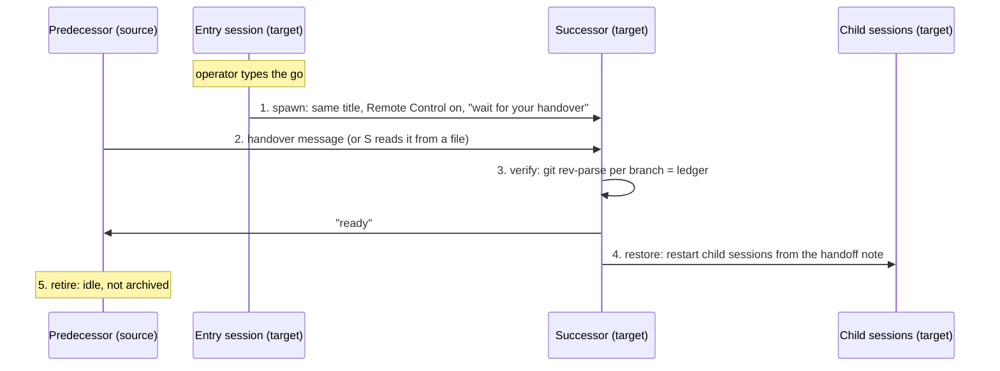

# How a lead session comes back on the target

Five steps, one owner each: the entry session spawns, the predecessor hands
over, the successor verifies and restores, the predecessor retires.

## Before step 1

- The wave's folders, clones and `~/.claude` are on the target (stage 6).
- The handoff notes are on the target. A private repo that holds them is the
  simplest route: the entry session pulls it.
- The target prerequisites hold ([target-setup.md](target-setup.md)).
- Decide how successors get Remote Control: the app setting "Connect new
  sessions to Remote Control" on the target, or the operator flips each
  successor's switch in its toolbar. A session turning it on for another can
  be stopped by a hook that rewrites the call: no verdict, no denial, and the
  successor stays off. Without Remote Control a successor can't see or
  message the coordinator or its predecessor.

## 1. Spawn (entry session)

- The operator types the go **in the entry session**. The app refuses to start
  sessions from a turn that another session's message began, so a relayed
  "go" doesn't work.
- One session per lead session in the wave, with:
  - the predecessor's title,
  - its sidebar section and working folder,
  - **Remote Control on**: by the target's "Connect new sessions to Remote
    Control" setting, or the operator flips the switch in the new session's
    toolbar. Check it shows on; if the entry session's own attempt went
    through without a verdict, assume it didn't take,
  - the model and effort the operator wants,
  - a short opening brief: "You are the successor of <title> on the target
    machine. Wait for your handover message" — or, when the handover is a
    file, "Read <path>/handover.md and follow it as your handover."
- The entry session doesn't read the lead session's state and doesn't start
  child sessions.
- It reports each new session's id to the coordinator.

## 2. Handover (predecessor → successor)

- The predecessor finds its successor in `ListAgents` as a Remote Control row
  with the same title. Two rows with one title: use the row's `[ref]`.
- It sends the handover message from
  [../templates/handover-message.md](../templates/handover-message.md).
- **Remote Control off on the predecessor:** it can't see Remote Control rows.
  It writes the handover to a file instead. Either the successor reads the
  file (opening brief above) or the coordinator relays it word for word.
- Session ids: record the `local_…` id from the session list, not the id in a
  transcript file name; they differ.

## 3. Verify (successor)

- For every repo and branch in the ledger: `git rev-parse <branch>` (and
  `origin/<branch>` after a fetch) equals the ledger's commit.
  `scripts/check-heads.sh <ledger> --fetch` does this. The ledger lists main
  clones only; worktrees don't exist yet and are recreated in step 4.
- Any mismatch: stop, report the exact output to the predecessor and the
  coordinator. Don't "fix" it by resetting.
- All match: reply "ready" to the predecessor (or to the coordinator, when
  it relayed the handover).

## 4. Restore (successor)

- Install dependencies, recreate worktrees at the paths in the handoff note.
- Restart child sessions from the handoff note's restart briefs, in its own
  sidebar section, nested under itself.
- Recreate its scheduled tasks **disabled**, if the handoff moves them. The
  coordinator (or the operator) disables them on the source, then the
  successor enables its copies. The predecessor is retired by then and does
  nothing more.
- **Some of this needs the operator.** The successor's first turns begin with
  another session's message (the handover), and the app refuses to create
  scheduled tasks or start sessions from such a turn: a session start turns
  into a card the operator clicks, a scheduled task is refused. Plan them as
  operator steps typed in the successor's own session ("create the scheduled
  tasks", "start the builders"), or as cards the operator clicks. The
  handover message lists them, so the operator knows to expect them.
- Message other successors to re-establish sync points.
- Report "restored" to the coordinator with a short note
  ([../templates/restored-note.md](../templates/restored-note.md)).
- Stay frozen: no ship, merge, push or publish until the coordinator lifts the
  wave's freeze.

## 5. Retire (predecessor)

- After "ready", the predecessor does nothing more on the source.
- Its last message to the successor says so. With Remote Control off it can't
  reach the successor: it gives that final note to the coordinator, who
  relays it word for word.
- It stays idle in the sidebar. It is not archived unless the operator asks.

## Sessions start on their own machine only

A session can start new sessions on its own machine, in the cloud, or on a
saved SSH host, not on the other Mac. So the entry session starts the
successors on the target, each successor starts its own child sessions, and
nothing on the source starts anything on the target. The operator can steer
any session on either machine over Remote Control.

The default is **no SSH**: Remote Control plus one click by the operator per
new session. SSH into a machine gives the whole user account (every file,
every signed-in CLI, any program run as that user), not just Claude Code.
If you still want one machine to start sessions on the other as a saved SSH
host, harden it:

- A private overlay network only (Tailscale or WireGuard). No port open on the
  LAN or the internet.
- Key-only authentication; `AllowUsers` for the one account, and
  `from="<peer IP>"` on its key in `authorized_keys`.
- One direction only.
- Ideally a separate, non-admin macOS user that can reach the work folders
  and nothing else.

The costs: that user has its own `~/.claude`, its own sign-ins, and a
different home path, so memory folders and absolute paths no longer match.

## A lead session that stays behind

Not every lead session has to move. One that depends on the source (a tool
or device only that machine has, a long job running there) can stay and be
used from the target over Remote Control.

Decide it before its wave freezes when you can. If a successor already
exists:

1. The successor hands back anything new: pushes its branches and sends a
   short note of what changed since the handover.
2. It removes what it created on the target: its worktrees, any registrations
   in your own tools, and its scheduled tasks.
3. The original is brought back: message it first (Remote Control can be
   turned on only for a session that has run a turn), then turn its Remote
   Control on. Re-enable its scheduled tasks on the source.
4. The successor is archived, only on the operator's own word typed on the
   target. A session with a live Remote Control client can't be archived:
   turn its Remote Control off first.

Record the stay-behind on the transfer board, with its address on the source.

## Rules

- One owner per step: entry session spawns, predecessor hands over,
  successor verifies and restores.
- Nothing ships, merges or pushes during steps 1–4.
- The wave's freeze holds until step 4 is done for every lead session in it.
